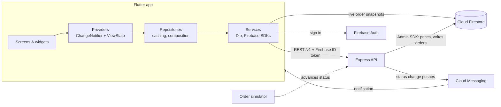

# QuickPlate

[](https://github.com/Nana-Abram/quickplate/actions/workflows/mobile.yml)
[](https://github.com/Nana-Abram/quickplate/actions/workflows/backend.yml)

**Order waakye, jollof, banku and tilapia or fufu from restaurants in Accra and Kumasi, and watch your food move from "placed" to "delivered" in real time.** A Flutter app (Provider, go_router, Firebase) with a small Node/Express API that prices orders and simulates the restaurant and rider.

<!-- Add captures to docs/screenshots/ and replace this block. Suggested: home, menu, cart, checkout map, live tracking, profile (dark). -->
| Home | Menu | Checkout | Live tracking |
|---|---|---|---|
| _screenshot coming soon_ | _screenshot coming soon_ | _screenshot coming soon_ | _screenshot coming soon_ |

<!-- Demo: a 20 to 30 second GIF of the full flow, e.g. docs/screenshots/demo.gif -->
_Demo GIF coming soon._

## Features

- **Accounts:** email/password sign-up and sign-in, password reset, and a session that survives restarts.
- **Browse:** a greeting header with search, photo category filters, a "Top rated" carousel, and a restaurant list with debounced search, infinite scroll, pull-to-refresh and a "closed" badge. The last page stays available offline.
- **Menus:** header image, sticky category tabs, and greyed-out dishes that are sold out.
- **Cart:** one restaurant at a time (with a "start a new cart?" prompt), quantities, kitchen notes, swipe to remove.
- **Checkout:** OpenStreetMap address picker with "use my location", saved addresses, and cash or demo card payment. The server, not the app, sets every price.
- **Live tracking:** a status timeline pushed from Firestore, arrival estimate, delivery map, and cancel while the restaurant has not accepted. It falls back to polling if the live connection fails.
- **Push notifications:** FCM on every status change. A tap opens the order, even from a cold start.
- **Order history, profile and themes:** status chips, saved addresses, and a light/dark/system theme that is remembered between launches.
- **Every data screen** has loading (shimmer), empty, error (with retry) and success states.
- **Look and feel:** a warm orange theme with the Plus Jakarta Sans typeface, and real photos of Ghanaian food on every restaurant and dish. The 18 sample restaurants are invented; the photos are openly licensed and credited in [docs/PHOTO_CREDITS.md](docs/PHOTO_CREDITS.md).

## Tech stack

| | |
|---|---|
| App | Flutter (Dart 3), **Provider** (`ChangeNotifier`), go_router, Dio |
| Firebase | Auth, Cloud Firestore (live order updates), Cloud Messaging |
| Maps | flutter_map + OpenStreetMap tiles, geolocator (no API key) |
| UI | Material 3 light/dark theme, cached_network_image, shimmer, shared_preferences |
| Backend | Node 22, Express 5, firebase-admin, zod validation, helmet, cors |
| Tests | flutter_test + mocktail (195 tests), vitest + supertest (60 tests) |
| CI | GitHub Actions: analyze, format check, tests, release APK artifact |

## Architecture



- **Layering:** screens → providers → repositories → services. Screens never touch Dio or Firebase, and providers never import widgets. Errors become typed `AppException`s with messages that are safe to show.
- **Writes go through the API, reads can be live.** The backend is the only writer of restaurants and orders. Firestore security rules give the app read access to its own orders, so tracking can listen live.
- **Money is integer pesewas** end to end and is formatted only in the UI.

More detail: [docs/ARCHITECTURE.md](docs/ARCHITECTURE.md) and the decision log in [docs/DECISIONS.md](docs/DECISIONS.md).

## Run it locally

You need Flutter (stable), Android Studio or the Android SDK, Node 20+, and a free Firebase project, plus the Firebase CLIs:

```sh
npm i -g firebase-tools && firebase login
dart pub global activate flutterfire_cli
```

1. **Firebase project.** Follow [docs/MANUAL_SETUP.md](docs/MANUAL_SETUP.md):
   - Create a project with Email/Password sign-in and a Firestore database.
   - Download a service account key to `backend/serviceAccountKey.json` (it is gitignored).
2. **Backend.**
   ```sh
   cd backend
   npm install
   cp .env.example .env
   firebase deploy --only firestore   # security rules + indexes; set your project id in .firebaserc first
   npm run seed                       # 18 restaurants in Accra, Tema and Kumasi
   npm run dev                        # http://localhost:4000/v1
   ```
3. **App.**
   ```sh
   cd mobile
   flutterfire configure              # generates lib/firebase_options.dart for your project
   cp .env.example .env               # API_BASE_URL: emulator http://10.0.2.2:4000/v1, phone http://<your-PC-LAN-IP>:4000/v1
   flutter pub get
   flutter run
   ```
4. Register, pick a restaurant and place an order. The status moves every 20 seconds (`SIM_STEP_SECONDS`). In debug builds, long-press the status on the tracking screen to skip ahead.

`firebase_options.dart` and `google-services.json` are client configuration and are committed on purpose. The data is protected by the Firestore security rules in [backend/firestore.rules](backend/firestore.rules), not by keeping these files secret.

## API summary

Base path `/v1`. Routes marked 🔒 need `Authorization: Bearer <Firebase ID token>`. Full table and error codes: [backend/README.md](backend/README.md).

| Method | Path | |
|---|---|---|
| GET | `/health` | Liveness check |
| GET | `/restaurants?q=&category=&limit=&cursor=` | Paged list, name-prefix search, category filter |
| GET | `/restaurants/:id`, `/restaurants/:id/menu` | Detail and menu grouped by category |
| POST | `/orders` 🔒 | Create; the server prices every line from Firestore |
| GET | `/orders`, `/orders/:id` 🔒 | History and one order (owner only) |
| POST | `/orders/:id/cancel` 🔒 | Only while `placed` (409 otherwise) |
| POST | `/orders/:id/advance` 🔒 | Demo only, behind `ENABLE_DEMO_ENDPOINTS` |
| PUT | `/me/device-token` 🔒 | Register an FCM token |

## Testing

```sh
cd mobile && flutter analyze && flutter test
cd backend && npm test
```

- **Mobile:**
  - Unit tests for every provider: loading, success, empty and error states, pagination, debounce, stale responses, optimistic updates and rollback.
  - Models, error mapping, the Dio auth interceptor's token refresh, and the Firestore timestamp conversion.
  - Widget tests for the main screens.
  - Accessibility checks: tap-target size, labels and contrast in light and dark mode, and layout at double text size.
- **Backend:** supertest against the real Express app and services, with in-memory fakes of Firestore, Auth and Messaging. Covers order pricing (including tampered prices being ignored), closed restaurants and unavailable items, ownership (403), the cancel rules, the simulator and push token pruning.

## Performance

Two concrete improvements from a rebuild audit (every widget that watched a whole provider was reviewed):

1. **The restaurant list rebuilds only when its rows change.** It used to watch all of `RestaurantsProvider`, so fetching the next page (which flips an `isLoadingMore` flag) rebuilt every visible card. It now selects just the list and whether a footer is needed; the footer watches its own loading state. Checkout got the same treatment for the cart.
2. **Images are decoded at the size they are drawn.** `AppNetworkImage` passes `memCacheWidth` (drawn width × device pixel ratio) to `cached_network_image`, so an 88 dp menu thumbnail decodes at about 264 px instead of the 600 × 400 source. Less memory per image and a faster first paint in long lists.

To check rebuilds yourself, run `flutter run --profile` and open the Flutter DevTools Performance view with "Track widget rebuilds" on.

**Caching**, from the network outwards:

| Layer | What is cached | For how long |
|---|---|---|
| Images | Every photo, on disk (`cached_network_image`) and decoded in memory | 30 days on disk |
| App memory | Restaurants seen in lists (for instant headers), the first page (for offline use), and menus | Menus 5 minutes, or until the app closes when offline |
| Firestore | Live order documents and saved addresses (Firestore's offline persistence) | Until Firestore evicts them |
| API memory | Restaurant pages, restaurants and menus | 60 seconds (`RESTAURANT_CACHE_SECONDS`) |
| HTTP | `Cache-Control: public, max-age=60` on restaurant responses | 60 seconds |

Prices are never served from a cache: the API re-reads every dish when an order is placed.

## Security

- **Secrets:** none in the repo or its history (checked with `git log --all -p`). The service account key, `.env` files, keystores and `key.properties` are gitignored.
- **Firebase client keys** in `firebase_options.dart` are public by design. The data is protected by [Firestore rules](backend/firestore.rules): restaurants are read-only, users read only their own orders, and the app may change only the saved addresses on its own user document (at most 10). Push tokens and orders are written by the API alone. The rules were checked against the live project with a test user.
- **API:** every order route checks the Firebase ID token and the order's owner. Input is validated with zod, bodies are capped at 100 kB, helmet sets security headers, and errors never include stack traces. Each client is rate limited separately, also behind Render's proxy (`TRUST_PROXY_HOPS`). The demo "advance" endpoint is off in production.
- **App:** release builds use HTTPS only and obfuscated Dart code. The ID token is never logged (network logging exists only in debug builds and skips headers). Android backup is off, so the signed-in session is not copied to the cloud, and the cart, orders and addresses are cleared when the user changes.
- **Dependencies:** `npm audit` reports no known vulnerabilities.

## Release build

- **Signed APK:**
  1. Create a keystore outside the repo:
     ```sh
     keytool -genkey -v -keystore ~/quickplate-release.jks -keyalg RSA -keysize 2048 -validity 10000 -alias quickplate
     ```
  2. Copy `mobile/android/key.properties.example` to `mobile/android/key.properties` (gitignored) and fill it in.
  3. Run `flutter build apk --release` with `API_BASE_URL` in `mobile/.env` pointing at the deployed API.
- **Without a key:** release builds fall back to the debug key, which is what CI does.
- **Backend on Render:** [render.yaml](render.yaml) defines the free web service. Create a Blueprint from this repo and paste the service account JSON into `FIREBASE_SERVICE_ACCOUNT_JSON`. The free tier sleeps when idle, so the first request after a while takes about 30 seconds.

## Known limitations

- **Simulated restaurant and rider:** status changes come from a timer, there are no real payments ("Card (demo)" charges nothing), and there are no restaurant or rider apps.
- **Search** matches the start of restaurant names only, because Firestore has no full-text search.
- **The cart** is kept in memory and empties when Android closes the app.
- **No reverse geocoding:** you type the street line and the map pin supplies the coordinates. There is no distance check between restaurant and address.
- **Simulator restarts:** simulator timers live in the API process, so orders stop advancing if the server restarts mid-delivery (the demo endpoint can move them on).
- **Sample data:** the restaurants are invented. Their photos load from Wikimedia Commons, Flickr and the WordPress Photo Directory, so they need a connection the first time (then they are cached).
- **iOS** builds are configured but not tested.

## Roadmap

- Persist the cart on the device.
- Full-text restaurant search (Typesense or Algolia).
- Real payments through a Ghanaian provider (mobile money).
- Rider location on the tracking map.
- Restaurant-side app to accept and prepare orders.
- Integration tests on a device in CI.

## Repository layout

```
mobile/    Flutter app
backend/   Node/Express API, seed script, Firestore rules and indexes
docs/      Spec, architecture, task plan, manual setup steps, decision log
```
